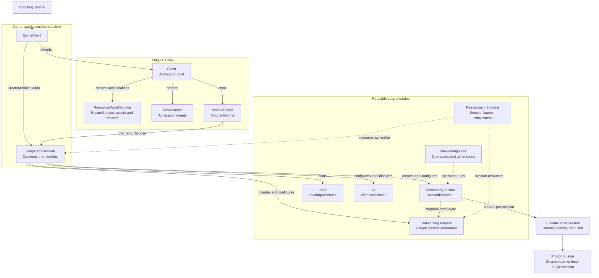
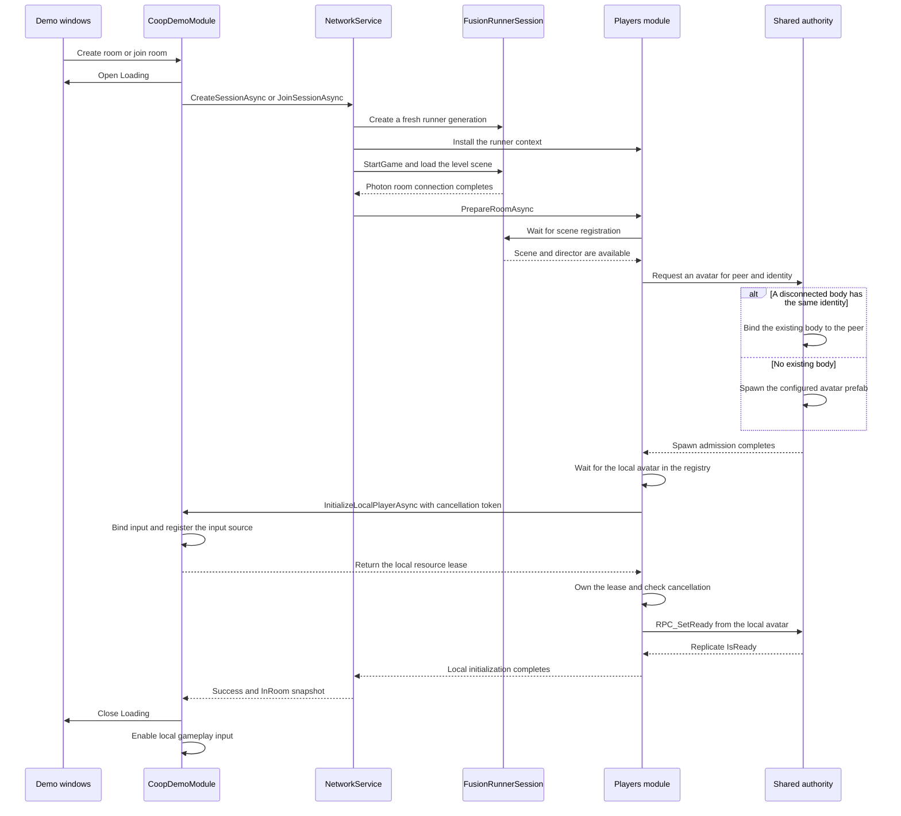
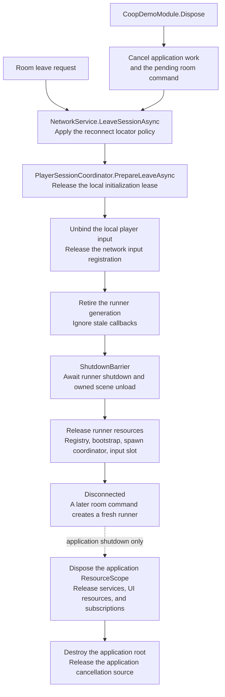

# Coop sessions

## Responsibility

The coop modules provide room connections, scene registration, player avatars, local input, windows, and resource cleanup.

## Parts

| Part | Folder page |
|------|-------------|
| Resource ownership | [Resources](resources.md) |
| Async component lifetime | [Lifetime](infra/lifetime.md) |
| Pure network operations | [Network core](networking/core.md) |
| Photon Fusion connection | [Fusion](networking/fusion.md) |
| Player lifetime | [Players](networking/players.md) |
| Local input | [Input](input/README.md) |
| Window stack | [Windows](ui/windows.md) |
| Demo composition | [Demo](game/demo.md) |

## How it works

1. `GameClient` adds `CoopDemoModule` to the existing module scope.
2. The module creates the network service, input service, windows, and player session coordinator.
3. A room command creates a fresh runner and installs its player context.
4. Fusion registers the level scene before the coordinator requests an avatar.
5. The authority admits the spawn request or binds an existing disconnected avatar.
6. The local bootstrap owns the application's initialization lease and publishes readiness after initialization completes.
7. A leave command retires the runner and releases its resources before another runner starts.

### Application composition

The original Core starts the application. `Game` composes the reusable coop modules and supplies the demo behavior.
Labels describe calls, ownership, and inheritance. Dotted lines show shared support code.

The demo reads input, sends movement requests through `DemoAvatar`, and blocks gameplay while a window is open.
Input does not depend on the network. Players does not depend on Input or UI.
The application callback connects those modules for each local avatar.
The Core assemblies do not reference `Game`.

### Room entry and local readiness

The Players module contains the coordinator, avatar registry, spawn coordinator, and local bootstrap.
The Shared master owns the director and avatar state. The application owns local input and presentation resources.

The room command completes after local readiness. A Photon connection alone does not close Loading.
Reconnect repeats this flow with a fresh runner and the same identity.
Another peer must keep the room alive for the director to restore a disconnected body.
`KeepReconnect` retains the local locator. `ForgetSession` clears it. Neither mode directly deletes the remote body.

### Leave and resource cleanup

An ordinary room leave releases session resources. The application input service and window service remain available for the menu.
Application shutdown also releases the application scope after the network leave completes.

The shutdown barrier releases runner resources after shutdown completes.
If shutdown cannot be confirmed, the service blocks runner replacement.
An initializer that fails before it returns a lease must release its own partial resources.

The [Editor launch diagram](game/editor.md#editor-launch-flow) shows how `root` starts one or two application instances.

## Rules

- Core modules do not reference `Game` or RATATA types.
- The Resources and network-core assemblies have no Unity references.
- Lifetime, Input, UI, Fusion, and Players have separate assembly definitions.
- A session owns its registry, spawn coordinator, local bootstrap, and input registration.
- Keep disconnected avatars while another peer keeps the room alive.
- A reconnect locator is not a server-side save system.
- The local identity selects a reconnect avatar. It does not authenticate an account.
- The first supported network topology is Fusion Shared Mode. Single mode supports local checks.
- The demo uses build-index scenes. Addressable scenes require explicit paths in `FusionSceneManager.AddressableScenePaths`.

## Related responsibilities

- [Bootstrap and lifecycle](bootstrap-and-lifecycle.md)
- [Asset management](asset-management.md)
- [Game starter](game-starter.md)

Practical guides: [Run the demo](../coop-demo.md), [Reuse the modules](../reuse-coop.md), and [Testing](../testing.md).
