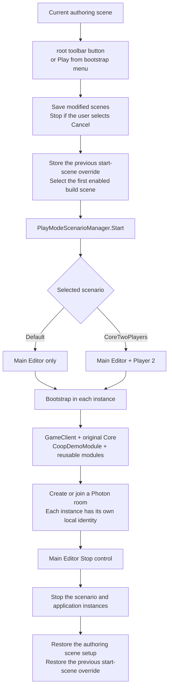

# Editor

Source folder: `Assets/Scripts/Game/Editor`. Files: DemoSetup.cs, BootstrapLoadMenu.cs.

Responsibility: [Coop sessions](../coop-sessions.md).

## Purpose

`Tools/Core/Create coop demo` creates the demo assets through Unity serialization. It sets the Bootstrap and World scenes in build settings. Fusion baking supplies prefab and scene metadata. Existing demo assets are reusable. This command replaces the generated demo scenes and prefab.

## Bootstrap play button

`BootstrapLoadMenu` provides the `root` toolbar button and `Tools/Core/Play from bootstrap` menu item.
The button selects the first enabled build scene as the temporary `EditorSceneManager.playModeStartScene`.
It then starts the selected Play Mode Scenario through `PlayModeScenarioManager`.
Unity restores the open scene setup after Stop. The helper restores the previous start-scene override.
Editor `SessionState` holds that override across domain reloads.

The helper ignores clicks while Unity compiles, updates, plays, or starts another scenario.
It respects Cancel in the scene-save dialog and checks that the first enabled scene asset exists.
The toolbar visibility is a local Editor preference. Enable `Core > StartPlay` in the toolbar context menu if needed.

## Multiplayer scenario

`Assets/Settings/PlayMode/CoreTwoPlayers.asset` contains a main Editor and one additional Editor named `Player 2`.
The main Editor starts from Bootstrap. The additional Editor follows the main Editor scene setup.
The project uses Multiplayer Play Mode `3.0.0`, as in the source project.
Choose `CoreTwoPlayers` in the scenario dropdown next to Play before you use `root`.
Choose `Default` for a single Editor or automated tests.

This tool starts two application instances. Use the demo menu to create and join the same Photon room.
Each online instance still needs a Fusion App ID. The tool does not put an App ID in project assets.

## Editor launch flow

The selected scenario controls the number of Editor instances. Each instance runs the same application composition independently.

The [coop session diagrams](../coop-sessions.md#application-composition) describe the runtime composition, room entry, and cleanup inside each instance.

## Fusion Editor compatibility

The Fusion 2.1.3 installer reads the local package manifest during Editor startup.
Additional Editors do not have that manifest. A guard in `Assets/Photon/Fusion/Editor/Fusion.Unity.Editor.cs` skips that installer work when the file is absent.
The main Editor still installs packages and updates Fusion defines through the original code path.
The Fusion Hub auto-popup also skips Editors without a local manifest. It must not create config assets in a read-only additional Editor.
